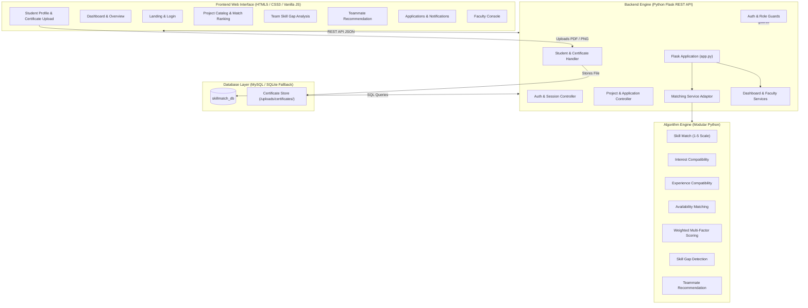

# 🌿 Student Skill and Project Matching System

[](https://www.python.org/)
[](https://flask.palletsprojects.com/)
[](https://www.mysql.com/)
[](#)

A centralized web-based platform designed to evaluate student profiles against academic project requirements using a **rule-based weighted matching algorithm** to generate compatibility scores, project recommendations, teammate discovery, skill gap analysis, and **verified skill certificate management**.

---

## 📌 Aim & Overview

Selecting suitable academic projects and assembling balanced teams with complementary technical skills is a significant challenge in engineering colleges. The **Student Skill and Project Matching System** replaces informal coordination with algorithmic matchmaking and verified credentials.

### Key Capabilities
- **Weighted Compatibility Engine**: Calculates holistic match percentages based on technical skills (50%), domain interests (20%), prior experience (20%), and time commitment (10%).
- **Skill Certificate Verification**: Students upload official certifications or coursework proof (PDF/PNG/JPG) for their claimed skills, which are verified to authenticate student proficiencies.
- **Project Recommendations**: Automatically ranks open academic projects tailored to student strengths.
- **Skill Gap Detection**: Analyzes current project teams to flag missing or insufficient skill proficiencies.
- **Teammate Discovery**: Suggests candidate students possessing the exact skills required to fill identified team gaps. A candidate only counts as closing a gap when their proficiency **meets or exceeds the level the project requires**, and candidates are ranked by the number of gaps they can close.
- **Application & Team Management**: Complete workflow for students applying to projects and faculty reviewing applicants.
- **Faculty Console**: A dedicated dashboard where project guides review applications, verify certificates and publish new projects.
- **Student Dashboard**: A single live view of profile health, statistics, the best project match with a full score breakdown, the skill garden and recent activity.
- **Personalised Factor Weights**: Students can switch individual factors off in their settings; the remaining weights are renormalised so the total always stays at 1.0.
- **Interest Controls**: Students choose their interest areas, which feed directly into the interest compatibility factor of the algorithm.

---

## 📐 System Architecture



---

## 🧮 Matching Formulation

The overall compatibility between a student $S$ and a project $P$ is computed using the **Rule-Based Weighted Scoring Model**:

$$\text{Match Score} = \sum (\text{Attribute Score} \times \text{Weight})$$

$$\text{Match Score} = (S_{\text{skill}} \times 0.50) + (S_{\text{interest}} \times 0.20) + (S_{\text{experience}} \times 0.20) + (S_{\text{availability}} \times 0.10)$$

### 1. Skill Compatibility ($50\%$)
Each required skill is evaluated against the student's claimed and verified proficiency level ($1$ to $5$):
$$\text{Skill Score}_i = \min\left(100, \frac{\text{Student Level}}{\text{Required Level}} \times 100\right)$$
$$S_{\text{skill}} = \frac{1}{N} \sum_{i=1}^N \text{Skill Score}_i$$

### 2. Interest Compatibility ($20\%$)
$$S_{\text{interest}} = \frac{|\text{Student Interests} \cap \text{Project Interests}|}{|\text{Project Interests}|} \times 100$$

### 3. Experience Compatibility ($20\%$)
$$S_{\text{experience}} = \frac{|\text{Student Experience} \cap \text{Project Experience}|}{|\text{Project Experience}|} \times 100$$

### 4. Availability Compatibility ($10\%$)
- Full-time student matching Full-time project: $100\%$
- Full-time student matching Part-time project: $100\%$
- Part-time student matching Full-time project: $50\%$
- Unavailable: $0\%$

### 5. Teammate Recommendation
For each skill gap with required level $L$, a candidate counts as covering that gap only if:
$$\text{Student Level} \geq L$$
Candidates are ranked by the number of gaps they close, then by total proficiency across the matched skills.

### 6. Customisable Factor Weights
Students can switch individual factors off in **Settings → Matching Preferences**. The remaining weights are renormalised so they always add up to $1.0$:
$$w'_i = \frac{w_i}{\sum_j w_j}$$

---

## 🗄️ Database Design


### 🔐 Access Control

The API distinguishes **read-only demo mode** from **authenticated actions**:

| Access | Endpoints | Behaviour |
| :--- | :--- | :--- |
| Anonymous (demo mode) | All `GET` endpoints | Read the seeded demo profile (Saara Rafi) so the app can be demonstrated without logging in |
| Logged-in student | Profile edits, skill CRUD, certificate upload, applications, notification read state | Requires a valid session — anonymous writes are rejected with `401` |
| Faculty / Admin | Certificate verification, application review, project creation | Requires a session **and** the `faculty`/`admin` role — students receive `403` |

---

## 📁 Project Structure

```
student-skill-project-matching/
├── algorithm/                      # Rule-based matching algorithms
│   ├── matching.py                 # Skill compatibility calculator
│   ├── interest_matching.py        # Interest compatibility calculator
│   ├── experience_matching.py      # Experience area matching
│   ├── availability_matching.py    # Availability commitment calculator
│   ├── weighted_matching.py        # 4-factor weighted score aggregator
│   ├── project_recommendation.py   # Ranking & sorting project suggestions
│   ├── skill_gap.py                # Detection of missing/insufficient skills
│   └── teammate_recommendation.py  # Teammate recommendation for missing gaps
├── backend/                        # Python Flask application
│   ├── app.py                      # Main Flask application & frontend server
│   ├── config.py                   # App & database configuration
│   ├── auth_utils.py               # Session helpers & role guards
│   ├── database.py                 # DB connection (MySQL with SQLite fallback)
│   ├── routes/                     # REST API route blueprints
│   │   ├── auth_routes.py          # Login, registration, session (/api/auth)
│   │   ├── student_routes.py       # Profile, skills, certificates, settings (/api/student)
│   │   ├── project_routes.py       # Project listing & applications (/api/projects)
│   │   ├── matching_routes.py      # Algorithm + dashboard endpoints (/api/matching)
│   │   ├── application_routes.py   # Application review & withdrawal (/api/applications)
│   │   ├── notification_routes.py  # User notifications (/api/notifications)
│   │   └── faculty_routes.py       # Faculty console (/api/faculty)
│   ├── services/
│   │   ├── matching_service.py     # Bridges DB records to algorithm logic
│   │   ├── dashboard_service.py    # Aggregated student dashboard payload
│   │   └── faculty_service.py      # Aggregated faculty console payload
│   └── uploads/
│       └── certificates/           # Secure storage for uploaded skill certificates
├── database/                       # Database scripts
│   ├── schema.sql                  # Complete MySQL schema DDL
│   ├── seed_data.sql               # Initial realistic test data
│   └── setup_mysql.py              # Interactive MySQL setup script
├── frontend/                       # Web interface (HTML5 / CSS3 / JS)
│   ├── index.html                  # Landing page
│   ├── login.html                  # Student & Faculty authentication + registration
│   ├── dashboard.html              # Main student dashboard
│   ├── profile.html                # Profile & certificate upload UI
│   ├── projects.html               # Project listings with match scores
│   ├── project-details.html        # Detailed project overview
│   ├── team.html                   # Current team & teammate recommendations
│   ├── gaps.html                   # Project skill gap analysis
│   ├── applications.html           # Project applications tracker
│   ├── notifications.html          # Notification center
│   ├── settings.html               # Matching, interest & notification preferences
│   ├── faculty.html                # Faculty console: reviews, verification, publishing
│   ├── css/style.css               # Base theme & page layouts
│   ├── css/design-system.css       # Tokens, typography, components, motion & a11y
│   ├── css/skillmatch-layout-fix.css  # Layout corrections for the garden pages
│   ├── js/main.js                  # Frontend API controller & animations
│   └── js/live.js                  # Database-driven rendering for every panel
├── tests/                          # Automated test suite
│   ├── test_algorithms.py          # Unit tests for the matching algorithms
│   ├── test_api.py                 # API integration tests (Flask test client)
│   └── test_frontend.py            # Frontend layout & stylesheet regression tests
├── requirements.txt                # Python package dependencies
├── run.py                          # 1-click startup script
└── README.md                       # Academic project documentation
```

### Frontend layout

Every page inside the app shares one shell, so the sidebar, header and
content area line up as you move between them:

```
<body class="app-body">
  <div class="app-layout">        <!-- grid: 240px sidebar + 1fr content -->
    <aside class="sidebar">…</aside>
    <main class="app-main">
      <header class="app-header">…</header>
      … page content …
    </main>
  </div>
</body>
```

Content areas use CSS grid throughout, so cards line up in even columns
rather than stacking:

| Section | Layout |
| :--- | :--- |
| Project cards | `repeat(auto-fill, minmax(320px, 1fr))` |
| Required skills / match analysis | `repeat(auto-fit, minmax(210px, 1fr))` |
| Statistic cards | 12-column grid, each card spans 4 |
| Skill garden | `repeat(auto-fit, minmax(100px, 1fr))` |

Below 1000px the layout collapses to a single column and the sidebar becomes
a scrollable strip; below 760px it becomes a slide-out menu.

### Design system

`frontend/css/design-system.css` holds the shared design language, loaded
after the base theme. It **adds to** the original olive-and-gold botanical
identity rather than replacing it — the deep-olive sidebar, the gold-bordered
buttons, the gold score rings and the skill plants that grow from a stem are
all left exactly as they were.

| Area | What it provides |
| :--- | :--- |
| Tokens | A 4px spacing scale, radius/elevation scales, a fluid type scale and motion tokens |
| Typography | Display headings scale fluidly with `clamp()`, while the small gold letterspaced labels keep their original treatment |
| Depth | Warm olive-tinted layered shadows and soft gold glows — the botanical glyph watermarks are untouched |
| Components | Pressed and disabled button states, gold focus rings on every input, matching progress gradients |
| Motion | Staggered reveals, hover lifts, a shimmering skeleton and a pulsing live dot — all disabled automatically under `prefers-reduced-motion` |
| Accessibility | Visible `:focus-visible` rings on links, buttons, inputs and selects, plus a `prefers-reduced-motion` fallback |

The palette stays olive and gold throughout: `#26351B` deep olive, `#536B32`
olive, `#C6A15B` gold, `#DFC98E` light gold, on warm paper and ivory.

---

## 🚀 Quick Start Guide

### 1. Clone & Set Up Environment

```bash
git clone https://github.com/saararafi/student-skill-project-matching.git
cd student-skill-project-matching

# Install required Python dependencies
pip install -r requirements.txt
```

### 2. Run the Application

You can start the full application immediately with:

```bash
python run.py
```

> **Zero-Configuration Mode**: The application includes an intelligent database adapter. If MySQL credentials are not provided or MySQL is offline, it automatically initializes a self-contained local SQLite database with all tables, seed data, and demo certificates!

Open your web browser and navigate to:
```
http://127.0.0.1:5000/
```

### 3. (Optional) Run with Local MySQL 8.0

If you wish to use a local MySQL server:
1. Make sure your MySQL service is running.
2. Run the interactive setup tool:
   ```bash
   python database/setup_mysql.py
   ```
3. Enter your MySQL host, username, and password. The script will automatically create `skillmatch_db`, import all tables, and seed the demo data.
4. Start the app: `python run.py`.

### 4. Run the Test Suite

```bash
# Runs both the algorithm unit tests and the API integration tests.
# The API tests use a throwaway SQLite database, so your dev data is untouched.
python -m unittest discover -s tests -v
```

---

## 🔌 API Reference

All endpoints return JSON. Read endpoints work in demo mode; write endpoints require a session.

### Authentication — `/api/auth`

| Method | Path | Access | Description |
| :--- | :--- | :--- | :--- |
| `POST` | `/login` | Public | Sign in, returns the user record |
| `POST` | `/register` | Public | Create a student account |
| `GET` | `/me` | Public | Current user (demo student when anonymous) |
| `POST` | `/logout` | Public | Clear the session |

### Student — `/api/student`

| Method | Path | Access | Description |
| :--- | :--- | :--- | :--- |
| `GET` | `/profile` | Public | Profile, skills, interests, completeness |
| `PUT` | `/profile` | Student | Update profile details |
| `GET` | `/skills` | Public | The student's skills + the master skill list |
| `POST` | `/skills` | Student | Add or update a skill |
| `DELETE` | `/skills/<id>` | Student | Remove a skill |
| `POST` | `/upload-certificate` | Student | Upload a certificate for a skill |
| `GET` | `/settings` | Public | Account details and preferences |
| `PUT` | `/settings` | Student | Save account details and preferences |
| `GET` | `/interests` | Public | Selected interest areas |
| `PUT` | `/interests` | Student | Replace the interest areas |
| `GET` | `/experiences` | Public | Previous work entries |
| `POST` | `/experiences` | Student | Add a previous work entry |
| `DELETE` | `/experiences/<id>` | Student | Remove a previous work entry |
| `GET` | `/certificates/<file>` | Public | Download an uploaded certificate |

### Projects — `/api/projects`

| Method | Path | Access | Description |
| :--- | :--- | :--- | :--- |
| `GET` | `/` | Public | All projects ranked by match score |
| `GET` | `/<id>` | Public | Project details, team and match breakdown |
| `POST` | `/<id>/apply` | Student | Apply to a project |
| `POST` | `/` | Faculty | Publish a new project |

### Matching — `/api/matching`

| Method | Path | Access | Description |
| :--- | :--- | :--- | :--- |
| `GET` | `/recommendations` | Public | Ranked project matches for the student |
| `GET` | `/dashboard` | Public | Everything the dashboard renders |
| `GET` | `/projects/<id>/gaps` | Public | Skill gap analysis for a project |
| `GET` | `/projects/<id>/teammates` | Public | Candidates who can close the gaps |
| `GET` | `/all-gaps` | Public | Gap summary across every project |

### Applications & Notifications

| Method | Path | Access | Description |
| :--- | :--- | :--- | :--- |
| `GET` | `/api/applications` | Public | Own applications (faculty sees all) |
| `PUT` | `/api/applications/<id>/status` | Faculty | Accept or reject an application |
| `POST` | `/api/applications/<id>/withdraw` | Student | Withdraw an own application |
| `GET` | `/api/notifications` | Public | Notifications for the current user |
| `POST` | `/api/notifications/<id>/read` | Student | Mark one notification as read |
| `POST` | `/api/notifications/read-all` | Student | Mark all notifications as read |

### Faculty Console — `/api/faculty`

| Method | Path | Access | Description |
| :--- | :--- | :--- | :--- |
| `GET` | `/overview` | Faculty | Projects, applications and pending certificates |
| `GET` | `/applications` | Faculty | Applications for this guide's projects |
| `PUT` | `/applications/<id>/status` | Faculty | Accept or reject an application |
| `GET` | `/certificates` | Faculty | Certificates awaiting verification |
| `PUT` | `/certificates/<student>/<skill>` | Faculty | Verify or reject a certificate |

---

## 📜 Skill Certificate Verification Workflow

1. **Student Upload**:
   - Navigate to the **Profile** page (`profile.html`).
   - Under **Technical Skills**, click **"+ Certificate"** next to any skill.
   - Choose a PDF, PNG, or JPG certificate (e.g. Coursera, NPTEL, HackerRank, University course).
   - Click **"Upload & Request Verification"**.
2. **Faculty Review**:
   - Sign in with a faculty account — you are redirected to the **Faculty Console** (`faculty.html`).
   - Under **Credentials**, open the certificate with **View** and approve it with **Verify** (or **Reject**).
3. **Proof**:
   - Uploaded certificates receive a **Pending ⏳** badge and a notification.
   - Anyone reviewing the student's profile or application can click the badge to preview the uploaded certificate in a new tab.
   - Verified certificates display a **Verified ✓** badge and enhance confidence ratings during team formation.

---

## 🧪 Testing

All matching algorithms in `algorithm/` are designed to be independently executable for unit testing and viva demonstrations:

```bash
# 1. Test individual skill matching
python algorithm/matching.py

# 2. Test multi-factor weighted matching formula
python algorithm/weighted_matching.py

# 3. Test project ranking and recommendations
python algorithm/project_recommendation.py

# 4. Test team skill gap detection
python algorithm/skill_gap.py

# 5. Test teammate discovery for missing skills
python algorithm/teammate_recommendation.py
```

### Automated Test Suite

The repository also ships with a standard-library test suite (no extra dependencies required):

```bash
python -m unittest discover -s tests -v
```

| File | Coverage |
| :--- | :--- |
| `tests/test_algorithms.py` | Unit tests for all eight algorithm modules — scoring bounds, weight maths, edge cases and ranking order |
| `tests/test_api.py` | API integration tests using the Flask test client — authentication, role guards, 404 handling and match-score consistency |
| `tests/test_frontend.py` | Frontend regression tests — every class used in the markup must have a rule in `style.css`, HTML tags must balance, ids must be unique, and all app pages must share one layout shell |

> The API tests run against a **throwaway SQLite database**, so they never modify `database/skillmatch.db`.

---

## 🔑 Demo Accounts for Evaluation

| Role | Email | Password | Details |
| :--- | :--- | :--- | :--- |
| **Student** | `saara@example.com` | `password123` | Full profile with Python, Java, HTML, MySQL skills + certificates |
| **Student** | `aisha@example.com` | `password123` | Python & Web developer |
| **Student** | `rahul@example.com` | `password123` | Java & Database specialist |
| **Student** | `meera@example.com` | `password123` | React & UI/UX specialist |
| **Faculty** | `priya.sharma@faculty.edu` | `password123` | Project Guide / Faculty Administrator |

> Log in through `login.html` to unlock the write actions (editing your profile, uploading certificates, applying to projects, reviewing applications as faculty). **Students are sent to the garden dashboard; faculty are sent to the project guide console.**

### Where to go next

| Page | What it does |
| :--- | :--- |
| `index.html` | Landing page explaining the system |
| `dashboard.html` | Profile health, statistics, your best project match with the full score breakdown, skill garden and recent activity |
| `projects.html` | Every project ranked by your compatibility, with search and filters |
| `project-details.html` | Requirements, your skill-by-skill fit, the gaps to close and the current team |
| `profile.html` | **Your details** — basic information, and add or remove skills, interests, previous work and availability |
| `team.html` | The current team roster, how much of the skill list they cover, and recommended teammates |
| `gaps.html` | Which skills the team is missing for the selected project |
| `applications.html` | Track and withdraw your applications |
| `settings.html` | Account details, matching preferences, interest areas and notification settings |
| `faculty.html` | **Faculty only** — review applications, verify certificates, publish projects |

### Editing your profile

Everything on the **Profile** page is editable and persists to the database:

| Section | What you can do | What it changes |
| :--- | :--- | :--- |
| Basic Information | Edit name, department, year, semester and bio | Your profile, shown to faculty and teammates |
| Technical Skills | Add a skill with a proficiency level, or remove one | The 50% skill factor of the match score |
| Interests / Preferred Domains | Add or remove interest areas | The 20% interest factor of the match score |
| Previous Work | Add or remove experience entries | The 20% experience factor of the match score |
| Availability | Switch between full-time and part-time | The 10% availability factor of the match score |
| Certificate | Upload a PDF/PNG/JPG proof for any skill | Faculty verification state |

Changes take effect immediately — the match scores are recalculated on the next
recommendation request.

---

## 🚀 Deploying to Render.com

The repository ships with a `render.yaml` blueprint, so deploying takes a
couple of clicks.

### One-click blueprint deploy

1. Push the project to GitHub.
2. In Render, choose **New → Blueprint**.
3. Select the repository — Render reads `render.yaml` and creates:
   - a **web service** running `gunicorn run:app`
   - a **free PostgreSQL database** wired up through `DATABASE_URL`
4. Wait for the build to finish, then open the generated URL.

The database is created and seeded automatically on the first request, so the
site is populated with the demo garden the moment it goes live.

### Manual deploy

1. **New → Web Service**, connect the GitHub repository.
2. Use these settings:

   | Setting | Value |
   | :--- | :--- |
   | Runtime | Python |
   | Build command | `pip install -r requirements.txt` |
   | Start command | `gunicorn run:app --preload --workers 1 --threads 4 --timeout 120` |
   | Health check path | `/api/health` |

3. Add the environment variables:

   | Key | Value |
   | :--- | :--- |
   | `SECRET_KEY` | *Generate* (Render can do this for you) |
   | `DATABASE_URL` | *From* → your PostgreSQL instance |
   | `SESSION_COOKIE_SECURE` | `1` |
   | `FLASK_DEBUG` | `0` |

4. Add a PostgreSQL instance under **New → Postgres** and link it.

### Which database is used?

The app picks the database automatically, so the same code runs everywhere:

| Situation | Engine used |
| :--- | :--- |
| `DATABASE_URL` is set (Render, Heroku, Railway) | **PostgreSQL** |
| MySQL is reachable and configured | **MySQL** |
| Neither | **SQLite** in `database/skillmatch.db` (local development) |

The schema is created and seeded on the first request, and existing
databases are migrated automatically when new columns are added.

### Local run

```bash
pip install -r requirements.txt
python run.py                 # http://127.0.0.1:5000
```

Copy `.env.example` to `.env` to change the database settings or the
session secret.

---

## 🎓 Academic Credit & Author

- **Project Title**: Student Skill and Project Matching System
- **Repository**: [saararafi/student-skill-project-matching](https://github.com/saararafi/student-skill-project-matching)
- **Author**: Saara Rafi
- **Department**: Computer Science and Engineering (5th Semester Mini Project)
