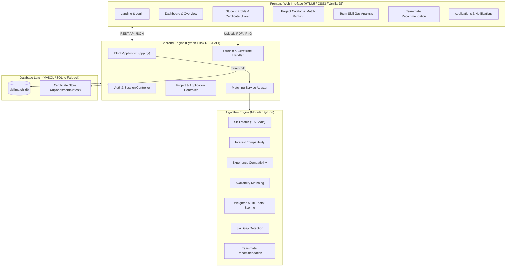
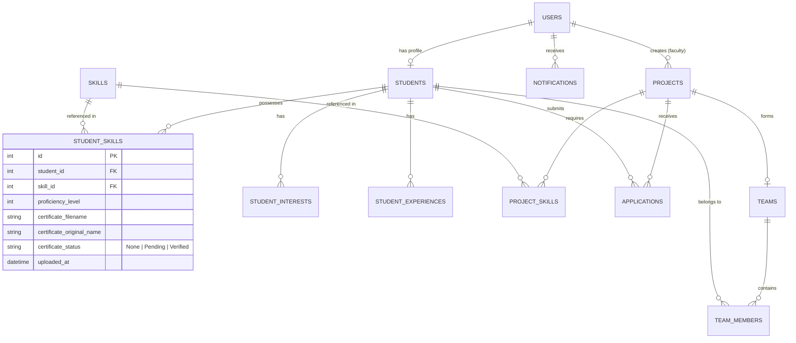

# 🌿 Student Skill and Project Matching System

[](https://www.python.org/)
[](https://flask.palletsprojects.com/)
[](https://www.mysql.com/)
[](#)

A centralized web-based platform designed to evaluate student profiles against academic project requirements using a **rule-based weighted matching algorithm** to generate compatibility scores, project recommendations, teammate discovery, skill gap analysis, and **verified skill certificate management**.

---

## 📌 Aim & Overview

Selecting suitable academic projects and assembling balanced teams with complementary technical skills is a significant challenge in engineering colleges. The **Student Skill and Project Matching System** replaces informal coordination with algorithmic matchmaking and verified credentials.

### Key Capabilities
- **Weighted Compatibility Engine**: Calculates holistic match percentages based on technical skills (50%), domain interests (20%), prior experience (20%), and time commitment (10%).
- **Skill Certificate Verification**: Students upload official certifications or coursework proof (PDF/PNG/JPG) for their claimed skills, which are verified to authenticate student proficiencies.
- **Project Recommendations**: Automatically ranks open academic projects tailored to student strengths.
- **Skill Gap Detection**: Analyzes current project teams to flag missing or insufficient skill proficiencies.
- **Teammate Discovery**: Suggests candidate students possessing the exact skills required to fill identified team gaps.
- **Application & Team Management**: Complete workflow for students applying to projects and faculty reviewing applicants.

---

## 📐 System Architecture



---

## 🧮 Matching Formulation

The overall compatibility between a student $S$ and a project $P$ is computed using the **Rule-Based Weighted Scoring Model**:

$$\text{Match Score} = \sum (\text{Attribute Score} \times \text{Weight})$$

$$\text{Match Score} = (S_{\text{skill}} \times 0.50) + (S_{\text{interest}} \times 0.20) + (S_{\text{experience}} \times 0.20) + (S_{\text{availability}} \times 0.10)$$

### 1. Skill Compatibility ($50\%$)
Each required skill is evaluated against the student's claimed and verified proficiency level ($1$ to $5$):
$$\text{Skill Score}_i = \min\left(100, \frac{\text{Student Level}}{\text{Required Level}} \times 100\right)$$
$$S_{\text{skill}} = \frac{1}{N} \sum_{i=1}^N \text{Skill Score}_i$$

### 2. Interest Compatibility ($20\%$)
$$S_{\text{interest}} = \frac{|\text{Student Interests} \cap \text{Project Interests}|}{|\text{Project Interests}|} \times 100$$

### 3. Experience Compatibility ($20\%$)
$$S_{\text{experience}} = \frac{|\text{Student Experience} \cap \text{Project Experience}|}{|\text{Project Experience}|} \times 100$$

### 4. Availability Compatibility ($10\%$)
- Full-time student matching Full-time project: $100\%$
- Full-time student matching Part-time project: $100\%$
- Part-time student matching Full-time project: $50\%$
- Unavailable: $0\%$

---

## 🗄️ Database Design



---

## 📁 Project Structure

```
student-skill-project-matching/
├── algorithm/                      # Rule-based matching algorithms
│   ├── matching.py                 # Skill compatibility calculator
│   ├── interest_matching.py        # Interest compatibility calculator
│   ├── experience_matching.py      # Experience area matching
│   ├── availability_matching.py    # Availability commitment calculator
│   ├── weighted_matching.py        # 4-factor weighted score aggregator
│   ├── project_recommendation.py   # Ranking & sorting project suggestions
│   ├── skill_gap.py                # Detection of missing/insufficient skills
│   └── teammate_recommendation.py  # Teammate recommendation for missing gaps
├── backend/                        # Python Flask application
│   ├── app.py                      # Main Flask application & frontend server
│   ├── config.py                   # App & database configuration
│   ├── database.py                 # DB connection (MySQL with SQLite fallback)
│   ├── routes/                     # REST API route blueprints
│   │   ├── auth_routes.py          # Login, registration, session (/api/auth)
│   │   ├── student_routes.py       # Profile & certificate upload (/api/student)
│   │   ├── project_routes.py       # Project listing & applications (/api/projects)
│   │   ├── matching_routes.py      # Real-time algorithm endpoints (/api/matching)
│   │   ├── application_routes.py   # Application review & status (/api/applications)
│   │   └── notification_routes.py  # User notifications (/api/notifications)
│   ├── services/
│   │   └── matching_service.py     # Bridges DB records to algorithm logic
│   └── uploads/
│       └── certificates/           # Secure storage for uploaded skill certificates
├── database/                       # Database scripts
│   ├── schema.sql                  # Complete MySQL schema DDL
│   ├── seed_data.sql               # Initial realistic test data
│   └── setup_mysql.py              # Interactive MySQL setup script
├── frontend/                       # Web interface (HTML5 / CSS3 / JS)
│   ├── index.html                  # Landing page
│   ├── login.html                  # Student & Faculty authentication
│   ├── dashboard.html              # Main student dashboard
│   ├── profile.html                # Profile & certificate upload UI
│   ├── projects.html               # Project listings with match scores
│   ├── project-details.html        # Detailed project overview
│   ├── team.html                   # Teammate recommendations
│   ├── gaps.html                   # Project skill gap analysis
│   ├── applications.html           # Project applications tracker
│   ├── notifications.html          # Notification center
│   ├── settings.html               # User preferences
│   ├── css/style.css               # Botanical garden design stylesheet
│   └── js/main.js                  # Frontend API controller & animations
├── requirements.txt                # Python package dependencies
├── run.py                          # 1-click startup script
└── README.md                       # Academic project documentation
```

---

## 🚀 Quick Start Guide

### 1. Clone & Set Up Environment

```bash
git clone https://github.com/saararafi/student-skill-project-matching.git
cd student-skill-project-matching

# Install required Python dependencies
pip install -r requirements.txt
```

### 2. Run the Application

You can start the full application immediately with:

```bash
python run.py
```

> **Zero-Configuration Mode**: The application includes an intelligent database adapter. If MySQL credentials are not provided or MySQL is offline, it automatically initializes a self-contained local SQLite database with all tables, seed data, and demo certificates!

Open your web browser and navigate to:
```
http://127.0.0.1:5000/
```

### 3. (Optional) Run with Local MySQL 8.0

If you wish to use a local MySQL server:
1. Make sure your MySQL service is running.
2. Run the interactive setup tool:
   ```bash
   python database/setup_mysql.py
   ```
3. Enter your MySQL host, username, and password. The script will automatically create `skillmatch_db`, import all tables, and seed the demo data.
4. Start the app: `python run.py`.

---

## 📜 Skill Certificate Verification Workflow

1. **Student Upload**:
   - Navigate to the **Profile** page (`profile.html`).
   - Under **Technical Skills**, click **"+ Certificate"** next to any skill.
   - Choose a PDF, PNG, or JPG certificate (e.g. Coursera, NPTEL, HackerRank, University course).
   - Click **"Upload & Request Verification"**.
2. **Review & Proof**:
   - Uploaded certificates receive a **Pending ⏳** badge.
   - Anyone reviewing the student's profile or application can click the badge to preview the uploaded certificate in a new tab.
   - Verified certificates display a **Verified ✓** badge and enhance confidence ratings during team formation.

---

## 🧪 Testing Standalone Matching Algorithms

All matching algorithms in `algorithm/` are designed to be independently executable for unit testing and viva demonstrations:

```bash
# 1. Test individual skill matching
python algorithm/matching.py

# 2. Test multi-factor weighted matching formula
python algorithm/weighted_matching.py

# 3. Test project ranking and recommendations
python algorithm/project_recommendation.py

# 4. Test team skill gap detection
python algorithm/skill_gap.py

# 5. Test teammate discovery for missing skills
python algorithm/teammate_recommendation.py
```

---

## 🔑 Demo Accounts for Evaluation

| Role | Email | Password | Details |
| :--- | :--- | :--- | :--- |
| **Student** | `saara@example.com` | `password123` | Full profile with Python, Java, HTML, MySQL skills + certificates |
| **Student** | `aisha@example.com` | `password123` | Python & Web developer |
| **Student** | `rahul@example.com` | `password123` | Java & Database specialist |
| **Student** | `meera@example.com` | `password123` | React & UI/UX specialist |
| **Faculty** | `priya.sharma@faculty.edu` | `password123` | Project Guide / Faculty Administrator |

---

## 🎓 Academic Credit & Author

- **Project Title**: Student Skill and Project Matching System
- **Repository**: [saararafi/student-skill-project-matching](https://github.com/saararafi/student-skill-project-matching)
- **Author**: Saara Rafi
- **Department**: Computer Science and Engineering (5th Semester Mini Project)
